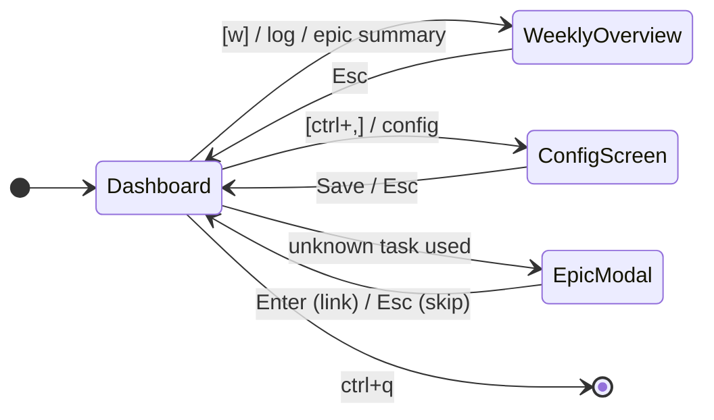

# User Interface Design

## Purpose

The Textual TUI is the sole interaction surface for TimeTracker. It provides a
persistent, full-screen dashboard that stays open all day. All time-tracking
commands are entered through the command bar at the bottom of the screen.

This document has two halves:

1. **Design Guidelines** — the abstract rules every screen obeys. These are
   stated without reference to any particular screen, so they can be applied
   to a screen that does not exist yet.
2. **Applied Design** — the actual screens, their elements, and the
   navigation between them.

When adding a new screen, read the guidelines first and extend them if the
new screen needs a rule that is not there yet.

---

## Current Behaviour

Running `python TimeTracker.py` always launches the TUI. There is no one-shot
CLI mode — all commands are entered from within the running application.

---

# Part 1 — Design Guidelines

## Surface Types

| Surface | Purpose | Dismissal |
|---------|---------|-----------|
| Dashboard | The permanent working surface. Always present, never dismissed. | — |
| Panel | A bordered region of the dashboard showing one category of information. | — |
| Overlay | A full-screen read-only view of data that does not fit the dashboard. | `Esc` |
| Modal | A blocking prompt that must be answered or skipped before work continues. | `Esc` skips |
| Screen | A full-screen editing surface with explicit Save / Close actions. | `Esc` discards |

An overlay never mutates data. A modal always offers a non-destructive escape.

## Panel Conventions

- Every panel is bordered and carries a `border_title` naming it. The title is
  the only label — panels do not repeat their name in the body.
- Panels are passive. They read and render; they never hold business rules.
- Fixed-height panels state their height in rows. Exactly one panel per column
  uses `height: 1fr` to absorb remaining vertical space.
- A panel wide enough for its longest possible row is sized to that row, with
  the worst case recorded as a comment next to the width declaration.

## Colour and Emphasis

Colour carries meaning and is never decorative. Every colour is paired with a
non-colour cue (weight, symbol, or wording) so nothing depends on colour alone.

| Role | Treatment | Used for |
|------|-----------|----------|
| Label | Dim | Field names in key/value rows |
| Value | Bold | The data itself |
| Active | Bold green + `▶` marker | The running session |
| Success | Normal or green, prefixed `✓` / `▶` / `📌` / `✅` | Completed command |
| Warning | Prefixed `⚠` | Recoverable problem |
| Error | Red, bold | Rejected command |
| Inactive | Dim | Absent data and empty states |
| Border | `$accent` | All panel borders |

## Duration and Time Formats

Two duration formats exist and they are never mixed in one column:

| Format | Shape | Used for |
|--------|-------|----------|
| Clock | `H:MM` | Reading a duration as time |
| Decimal | `N.N` / `N.NN` | Totals that feed a registration system |

Rules:

- Decimal durations carry an `h` suffix in compact single-value contexts
  (`5.8h`), and no suffix in a table column where the header names the format.
- Where both formats appear on the same row, clock is the left column and
  decimal the right, so they are distinguishable at a glance.
- A target pairs with its actual as `actual/target` — `5.8h/7.4h`.
- Clock times are 24-hour `HH:MM`. A projected or estimated time is prefixed
  `~`.
- A running session shows `Now` where a closed session shows its end time.

## Numeric Display

- Remainders are clamped to zero. The UI never shows negative remaining time.
- Projections that cannot be calculated render as `—`, never as `0` or blank.
- A value that depends on configuration shows both variants when the
  configuration leaves the outcome genuinely open, with the condition in
  parentheses — `~15:00 / ~15:30 (w/ lunch)`.

## Empty States

Every data panel defines an explicit empty state. Empty states are dim, are
full sentences, and say what is absent rather than showing nothing:
`No sessions recorded today.`

Where a richer fallback exists it is shown instead — an idle Active Session
panel reports the last closed session rather than only reporting emptiness.

## Refresh Cadence

Refresh rate matches the precision the value actually needs.

| Cadence | Applies to |
|---------|-----------|
| 1 second | A live running counter |
| 60 seconds | Aggregates and totals |
| Never | Static placeholders |
| On change | All data panels, after every mutating command |

Sub-minute precision is not meaningful for an aggregate, and polling faster
than the data changes is wasted work.

## Keyboard Model

The interface is keyboard-only; mouse support is not implemented.

| Key | Universal meaning |
|-----|-------------------|
| `Enter` | Submit or confirm |
| `Esc` | Cancel the innermost thing — input, then add-field, then overlay |
| `↑` / `↓` | Move within a list, or browse command history |
| `←` / `→` | Move between time periods |
| `Tab` / `Shift+Tab` | Cycle panel focus |
| `Ctrl+<key>` | Application-level action |

`Esc` is always non-destructive: it discards unsaved input, never stored data.

## Command Feedback

- Every mutating command writes a confirmation to the Output panel.
- Every confirmation names what changed and the time it changed at.
- A command that only refreshes the display writes nothing — silence means
  nothing changed.
- Multi-step commands emit one line per step, in the order they happened.

## Navigation Principles

- One concept has one destination. Multiple routes may lead to the same
  overlay, but a given view exists only once.
- Navigation is never more than one level deep from the dashboard.
- The dashboard is always one `Esc` away.
- Forward navigation in time is capped at the present — future periods cannot
  be viewed.

---

# Part 2 — Applied Design

## Navigation Map



Every surface returns to the dashboard. There is no path from one overlay to
another.

---

## Layout

```
┌─ TimeTracker ───────────────────────────────────────────────────────────────┐
│                                                                             │
│  ┌─ Active Session ───────────────────────────┐  ┌─ Quick Stats ──────┐    │
│  │  TASK-4321                                 │  │  Today    5.8h/7.4h│    │
│  │  Epic: Platform Ops                        │  │  Rem.     1.6h     │    │
│  │                                            │  │  Leave   ~15:42    │    │
│  │  Running  02:37:14   Started  09:00        │  │  Week    31.2h     │    │
│  └────────────────────────────────────────────┘  │  Sessions 3        │    │
│                                                   └────────────────────┘    │
│  ┌─ Today's Timeline ─────────────────────────────────────────────────────┐│
│  │  #1  07:00 – 08:30  TASK-1111  1.5h                                   ││
│  │  #2  08:30 – 09:00  TASK-2222  0.5h                                   ││
│  │  #3  09:00 – Now    TASK-4321  2.6h  ▶                                ││
│  └────────────────────────────────────────────────────────────────────────┘│
│  ┌─ Task Notes ───────────────────────────────────────────────────────────┐│
│  │  Notes for the active task will appear here.                          ││
│  │  (Obsidian integration — not yet implemented)                         ││
│  └────────────────────────────────────────────────────────────────────────┘│
│  ┌─ Output ───────────────────────────────────────────────────────────────┐│
│  │  ✓ Session started: TASK-4321 at 09:00                                ││
│  │  ✓ Previous session closed: TASK-1234 (1.50h)                         ││
│  └────────────────────────────────────────────────────────────────────────┘│
│  > type a command…                                                          │
│  [w] Weekly Overview  [ctrl+q] Quit                                         │
└─────────────────────────────────────────────────────────────────────────────┘
```

Vertical order: Active Session + Quick Stats (top row) → Today's Timeline →
Task Notes → Output → Command input → Footer. The Task Notes panel uses
`height: 1fr` and fills all remaining vertical space between the fixed-height
panels.

---

## Panels

### Active Session panel (top-left)

Displays the currently running session and its context.

- **Active state** — bold task ID on the first line; `Epic: <name>` on the
  second line (omitted when the task has no Epic link); a live running-time
  counter in `HH:MM:SS` format alongside the session start time. The
  counter ticks once per second.
- **Idle with prior sessions today** — dimmed "No active session" plus a
  `Last ended HH:MM (TASK-ID)` line referencing the most recently closed
  session.
- **Idle, empty day** — dimmed "No active session" only.

Sessions do not store a separate task-name field, so the ID doubles as the
label.

### Quick Stats sidebar (top-right)

Five compact metrics:

- `Today` — logged hours / configured daily target (decimal, e.g. `5.8h/7.4h`).
- `Rem.` — remaining hours today / remaining hours for the current ISO week
  (e.g. `1.6h/2.8h`). The weekly remainder is the weekly target (see `Week`
  below) minus the week total so far. Both values are clamped to zero once
  their respective targets are reached.
- `Leave` — projected leave time, i.e. when the daily target is met if work
  continues uninterrupted. Renders as `—` when no session is active or the
  target is already reached.
  When lunch is configured as **excluded from working hours** and no `Lunch`
  session has been logged yet, two projections are shown:
  `~15:00 / ~15:30 (w/e lunch)` — the second assumes the configured lunch
  break is still to be taken. The second figure disappears once lunch is
  logged, and is never shown when lunch is paid working time. See
  [Lunch section](../detailed-design/configuration.md#lunch-section).
- `Week` — total hours logged for the current ISO week (Mon–Sun) followed by
  the weekly target (`logged/target`). The target is
  `daily_target × number_of_days_with_registration_this_week` — e.g. on a
  Wednesday with three registered days the target is `3 × 7.4h = 22.2h`.
  Weekend sessions are included in both figures.
- `Sessions` — count of sessions recorded today (closed + active).

Refreshes every 60 seconds and after every mutating command.

### Today's Timeline panel (full width)

Chronological list of today's sessions with a fixed visible height of ~5–6
rows. Longer days scroll internally; the active session is scrolled into
view automatically.

Columns per row: `#N`, start `HH:MM`, separator `–`, end `HH:MM` (or `Now`
for the active session), task ID, right-aligned duration in decimal hours
(`N.Nh`), and a `▶` marker on the active row. The active row is styled
bold green; closed rows are normal weight.

Empty state: `No sessions recorded today.`

Refreshes every 60 seconds and after every mutating command.

### Task Notes panel (full width)

Static placeholder for future Obsidian note integration. Renders two
dimmed lines and does not read any data source. Uses `height: 1fr` so it
expands to fill all remaining vertical space.

### Output panel

Compact fixed-height display (approximately 3 message lines) showing the
most recent command results. Error messages are red/bold; success messages
are normal or green. Not scrollable from the dashboard — full week history
is accessed via the Weekly Overview overlay (`[w]`).

---

## Commands

All commands are entered via the command bar. See
[Commands](../detailed-design/commands.md) for full reference including
syntax, arguments, and output examples.

| Command | Behaviour in TUI |
|---------|-----------------|
| `start [hhmm] [epic]` | Opens session; confirmation in Output; shows Task–Epic modal if task is new |
| `lunch [hhmm]` | Opens Lunch session; confirmation in Output; no Task–Epic modal |
| `pause [hhmm]` | Closes session; confirmation in Output |
| `stop [hhmm]` | Closes session; all panels refresh |
| `resume [hhmm]` | Close + reopen, carrying epic; shows Task–Epic modal if carried task is new |
| `task <epic> [-s N]` | Tags session; confirmation in Output; shows Task–Epic modal if task is new |
| `status` | Refreshes the cockpit panels immediately (no Output message) |
| `log [wNN]` | Opens the Weekly Overview overlay |
| `promark [wNN]` | Writes the Promark table to Output (applies configured settings) |
| `epic add <name>` | Creates a new Epic; confirmation in Output |
| `epic list` | Lists all Epics alphabetically in Output |
| `epic summary [wNN]` | Opens the Weekly Overview overlay |
| `config` | Opens the Configuration screen |

---

## Configuration Screen

Opened by typing `config` in the command bar or pressing `Ctrl+,`.

The configuration screen is a scrollable modal overlay with four sections:

1. **Daily work target** — radio group: 37-hour week (7h 24m), 40-hour week
   (8h), or Custom (any positive decimal ≤ 24h).
2. **Lunch** — radio group: Included in working hours (paid) or Excluded from
   working hours (your own time, default); plus the Lunch duration in minutes
   (default 30), used for the registered day span and the leave projection.
3. **Excluded from working hours** — task list; entries are filtered out of
   hours totals and the progress bar (but still visible in all panels).
4. **Always separate (Promark only)** — task list; entries appear as standalone
   rows in Promark output (hours only) rather than being folded into the
   consolidated day entry.

**[Save]** validates all fields and writes to the database.
**[Close]** / `Esc` discards all in-memory changes without saving.

See [Configuration](../detailed-design/configuration.md) for the full reference.

---

## Log Overlay

Superseded by the [Weekly Overview overlay](#weekly-overview-overlay). The
typed `log` command and the `[w]` key binding both open the same overlay.

---

## Task–Epic Modal

Appears automatically when a task identifier used in `start`, `resume`, or
`task` has no entry in the Epic Catalog (`task_catalog`). The modal fires at
most once per task — after a link is written it does not reappear.

**State 1 — Epic selection list:**

```
┌─ New task: TASK-789 ──────────────────────────────────────┐
│  Select an Epic to link this task, or press Esc to skip.  │
│                                                           │
│  ► Platform Team                                          │
│    Mobile App                                             │
│                                                           │
│  [ + New epic… ]                                          │
│                                                           │
│  [↑↓] navigate   [Enter] select   [Esc] save as (Misc)   │
└───────────────────────────────────────────────────────────┘
```

- `↑` / `↓` navigate; `Enter` confirms the selection.
- Selecting an existing Epic writes the `task_catalog` entry and closes the modal.
- Selecting `[ + New epic… ]` transitions to State 2.
- `Esc` closes without linking; the task is treated as `(Misc)` in `epic summary`.

**State 2 — Inline Epic creation:**

```
┌─ New task: TASK-789 ──────────────────────────────────────┐
│  New Epic name:                                           │
│  ┌───────────────────────────────────────────────────┐   │
│  │ Platform Team_                                    │   │
│  └───────────────────────────────────────────────────┘   │
│                                                           │
│  [Enter] create & link   [Esc] back to list               │
└───────────────────────────────────────────────────────────┘
```

- `Enter` with a non-empty name: creates the Epic, writes `task_catalog`, closes modal.
- `Enter` with an empty name: no-op (stays open).
- Duplicate name: inline error shown; stays in State 2.
- `Esc`: returns to State 1.

---

## Weekly Overview overlay

Opened with the `[w]` key binding, or by typing `log`, `epic summary`, or
`epic summary wNN` in the command bar. All three routes open the same modal.
The overlay shows time grouped **day → Epic → task** for one ISO week, with
two duration columns on every row so both time-registration formats can be
read off directly.

```
╔═ Weekly Overview  (Jun 16 – Jun 22)    ◄  Week 26/2026  ► ═══════════════╗
║                                                    HH:MM   Decimal        ║
║                                                                            ║
║   Monday Jun 16    07:00 → 11:00                    4:00     4.00         ║
║     Platform Team                                   2:30     2.50         ║
║       TASK-123                                      2:30     2.50         ║
║     (Misc)                                          1:30     1.50         ║
║       TASK-789                                      1:00     1.00         ║
║       (no task)                                     0:30     0.50         ║
║                                                                            ║
║   Tuesday Jun 17   08:00 → 10:00                    2:00     2.00         ║
║     Platform Team                                   2:00     2.00         ║
║       TASK-123                                      2:00     2.00         ║
║                                                                            ║
║   Week total                                        6:00     6.00         ║
║                                                                            ║
║   [Esc] close   [←] prev week   [→] next week                             ║
╚════════════════════════════════════════════════════════════════════════════╝
```

- Day header rows, Epic subtotals, and task rows all carry both duration
  columns. Left column is base-60 clock (`HH:MM`); right column is decimal
  hundredths of an hour (no `h` suffix, so the two columns are easy to tell
  apart at a glance).
- Each day header shows a **consolidated day span**
  (`first_start → first_start + worked_time + lunch`) beside the day label.
  This is the same span the `promark` command emits, so the start/end times a
  registration system expects can be read directly off the overlay. Days
  with no closed sessions omit the span. The span honours the same
  configuration as `promark`: always-separate tasks are excluded from the
  span, and when lunch is configured as excluded from working hours the
  `Lunch` sessions are removed and the configured **lunch duration** is added
  to the end time instead — always the full configured duration, regardless
  of the actual break taken.
- Tasks with no `task_catalog` entry are grouped under `(Misc)` within
  their day. `(Misc)` is a virtual group — it is not stored and does not
  appear in `epic list`.
- Sessions that were never tagged with a task label are also included and
  appear under `(Misc)` with the placeholder label `(no task)`. Untagged
  time is not hidden.
- The week indicator `◄  Week NN/YYYY  ►` is right-aligned in the panel
  title.
- `←` / `→` navigate weeks; forward navigation is capped at the current
  ISO week (future weeks cannot be viewed).
- `Esc` closes the overlay and returns to the dashboard.

The previous separate `LogScreen` (individual session rows) and
`EpicSummaryScreen` (Epic totals in `HH:MM` only) have been replaced by
this single overlay — see the completed feature
`features/completed/ui-layout-redesign.md`.

---

## Keyboard Reference

| Key | Action |
|-----|--------|
| `Enter` | Submit command |
| `↑` / `↓` | Browse command history (within the session) |
| `Esc` | Clear command input (or close overlay / cancel add-input) |
| `Tab` / `Shift+Tab` | Cycle focus between panels |
| `w` | Open the Weekly Overview overlay for the current week |
| `ctrl+,` | Open the Configuration screen |
| `ctrl+q` | Quit the TUI |
| `←` / `→` (in Weekly Overview overlay) | Navigate between weeks |
| `↑` / `↓` (in Task–Epic modal) | Navigate the Epic list |
| `Enter` (in Task–Epic modal) | Select Epic or confirm new name |
| `Esc` (in Task–Epic modal State 1) | Skip linking (save as Misc) |
| `Esc` (in Task–Epic modal State 2) | Return to Epic selection list |
| `Esc` (in Config screen, add-input visible) | Cancel the add-input |
| `Esc` (in Config screen, no add-input) | Close the config screen without saving |

---

## Auto-Refresh

The Active Session panel ticks **once per second** so the running-time
counter stays current without user action.

The Quick Stats sidebar and Today's Timeline panel refresh every
**60 seconds** — the counters and totals they display do not need sub-minute
precision.

All three data-driven panels also refresh immediately after every mutating
command (via `TuiAppContext.on_session_changed()`).

The Task Notes panel is a static placeholder — it has no data source and
never refreshes.

The Output panel does not use a timer — it updates only in response to
commands.

---

## Limitations

- Mouse support is not implemented (keyboard only).
- Command history is session-scoped — it is not persisted to disk.
- The `?` help keybinding is not yet implemented.
- The `status` command refreshes the cockpit panels but does not write to Output.
- Week navigation in the Weekly Overview overlay is capped at the current
  week; future weeks cannot be viewed.
- The Task Notes panel is a static placeholder — the Obsidian integration
  is a separate future feature.
- Sessions do not store a task-name field; the Active Session panel and
  Today's Timeline show the task ID only, not a separate task name.

---

## Decisions

**2026 — Single persistent dashboard instead of one-shot commands**
- Decision: The TUI is the only interaction surface and stays open all day.
- Rejected: The original one-shot CLI (`python TimeTracker.py start`).
- Driver: `Preference` — the tool is used continuously, and two entry points
  meant maintaining two output formats.

**2026 — Both duration formats shown on every Weekly Overview row**
- Decision: Clock (`H:MM`) and decimal columns appear side by side.
- Rejected: A single format with a toggle between them.
- Driver: `Business` — the registration system takes decimal while humans
  reason in clock time. A toggle would mean re-reading the screen to transcribe
  a single day.

**2026 — Three routes open one Weekly Overview**
- Decision: `[w]`, `log`, and `epic summary` all open the same overlay,
  replacing the separate `LogScreen` and `EpicSummaryScreen`.
- Rejected: Keeping distinct views per command.
- Driver: `Technical` — the two screens showed the same data at different
  grouping levels and drifted apart in formatting.

**2026 — Untagged time is shown, not hidden**
- Decision: Sessions with no task appear under `(Misc)` as `(no task)`.
- Rejected: Omitting untagged sessions from the overlay.
- Driver: `Business` — hidden time makes week totals fail to reconcile, and
  the gap is exactly what the user needs prompting to fix.

**2026 — Forward week navigation capped at the current week**
- Decision: `→` stops at the current ISO week.
- Rejected: Allowing navigation into future weeks.
- Driver: `Preference` — a future week is always empty, so the only outcome is
  a confusing blank screen.

**2026 — Flat configured lunch duration rather than actual break length**
- Decision: When lunch is excluded, the full configured duration is added to
  the day span regardless of the logged break.
- Rejected: Using the measured `Lunch` session length.
- Driver: `Business` — the employment terms define a fixed unpaid break; the
  registration must reflect the contract, not the stopwatch.

**2026 — Remainders clamped to zero**
- Decision: `Rem.` never shows a negative value.
- Rejected: Showing overtime as a negative remainder.
- Driver: `Preference` — a negative remainder reads as an error; overtime is
  visible from the `Today` row.

**2026 — `Esc` in the Task–Epic modal skips rather than blocks**
- Decision: An unknown task can be saved unlinked and falls under `(Misc)`.
- Rejected: Requiring an Epic before the session can start.
- Driver: `Business` — clocking in must never be blocked by categorisation;
  the data can be corrected later, lost time cannot.

---

## Notes

- Sessions have no separate task-name field, so the task ID is also the label
  shown in the Active Session panel and Today's Timeline.
- `(Misc)` is a virtual group computed at query time. It is not stored and
  does not appear in `epic list`.

---

## Related Documents

- [Documentation Index](../index.md)
- [Commands](../detailed-design/commands.md) — full command reference.
- [Configuration](../detailed-design/configuration.md) — settings and their effects.
- [Epic Catalog](../detailed-design/epic-catalog.md) — Epics, task linking, and the modal.
- [Architecture](architecture.md) — why panels call shared calculations.

### Source feature documents

- `features/textual.md` — original Textual TUI design document.
- `features/completed/ui-layout-redesign.md` — cockpit layout and Weekly
  Overview overlay.
- `features/completed/lunch-configuration.md` — lunch handling and the dual
  leave projection.
